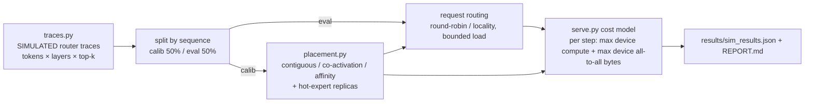

# moe-routing-sim

An expert-parallel Mixture-of-Experts serving simulator. It compares **expert-locality-aware routing**
with naive routing and reports cross-device traffic, load imbalance and modeled throughput.

> **Every number in this repo is SIMULATED.** The router traces are synthetic, with realistic skew,
> and the serving cost is an analytic model with **assumed** hardware numbers. No real MoE model or GPU
> cluster was run. I could not capture real router traces this time. See *Limits*.

## What it is

In expert parallelism, each device holds a slice of the experts. A token's hidden state must travel
to every device that holds one of its top-k experts, then come back. This all-to-all traffic often
limits MoE serving. The simulator tests whether placing experts and routing requests by
**which experts a request is likely to use** cuts that traffic, and what it costs in load balance.

## Why

Expert popularity in real MoEs is skewed, and requests from one domain reuse similar experts. Naive
serving ignores both. It places experts in contiguous blocks and assigns requests round-robin. A
locality-aware server can co-locate the experts a request group needs, send each request to that
group's device, and copy the hottest experts to every device.

## Architecture



## How it works

- **Traces** (`moesim/traces.py`): each layer has a global Zipf expert popularity (a = 1.1), mixed 50/50
  with a per-domain Dirichlet preference. Each sequence has one of 8 domains. A lower *domain
  concentration* means stronger request→expert locality. Tokens sample k distinct experts (Gumbel top-k).
- **Placement** (`moesim/placement.py`), always fit on the calibration half only:
  - `contiguous`: expert e goes to device e·D/E (the naive layout).
  - `coactivation`: per layer, greedily co-locate experts that the same token picks together.
  - `affinity`: cluster calibration requests into D groups (balanced cosine k-means on expert-usage
    profiles), then give each device the experts its group uses most, in **every** layer.
    Each device holds the same number of experts, and token load is capped at 1.1 × mean.
- **Request routing** (`moesim/serve.py`): round-robin, or *locality*. Locality uses a request's first
  16 tokens to find the device that holds most of its experts. Load is bounded at 1.1 × mean.
- **Replicas**: the top-2 experts per layer are copied to every device and served locally.
- **Cost model** (ASSUMED hardware: d_model 2048, expert d_ff 1024, bf16, 400 TFLOP/s and 50 GB/s
  link per device, 512 tokens per device per step). For each step and layer, time = max device
  expert compute + max device all-to-all bytes (dispatch + combine, once per token × remote device).

```bash
make setup && make test   # 15 tests, < 1 s
make run                  # full sweep (~1 min): 3 locality levels × 4/8/16 devices × 5 policies
```

## Results (SIMULATED)

Generated by `scripts/run_sim.py` → `results/REPORT.md` and `results/sim_results.json`.
The run: 64 experts, top-4, 8 layers, 384 requests × 128 tokens, seed 20261110.

**SIMULATED.** Synthetic router traces (Zipf global popularity × per-domain Dirichlet preference) and an
analytic cost model with ASSUMED hardware: {'d_model': 2048, 'd_ff_expert': 1024, 'bytes_per_act': 2, 'tflops_per_device': 400.0, 'link_GBps_per_device': 50.0, 'tokens_per_step_per_device': 512, 'label': 'ASSUMED hardware'}.

#### domain concentration 0.1 (strong request→expert locality)

| devices | policy | remote expert hits | remote devices / token·layer | cross-device KB / token | traffic vs naive | load imbalance (max/mean) | sim throughput vs naive |
|---|---|---|---|---|---|---|---|
| 4 | naive: contiguous experts, round-robin requests | 75.0% | 2.10 | 134.3 | 1.00× | 1.06 | 1.00× |
| 4 | co-activation placement, round-robin requests | 74.9% | 2.05 | 131.2 | 0.98× | 1.27 | 0.99× |
| 4 | affinity placement, round-robin requests | 75.7% | 1.98 | 126.7 | 0.94× | 1.12 | 1.03× |
| 4 | locality-aware: affinity placement + locality request routing | 55.4% | 1.71 | 109.4 | 0.81× | 1.12 | 1.08× |
| 4 | locality-aware + 2 hot-expert replicas/layer | 42.6% | 1.38 | 88.3 | 0.66× | 1.13 | 1.23× |
| 8 | naive: contiguous experts, round-robin requests | 87.5% | 2.97 | 190.2 | 1.00× | 1.21 | 1.00× |
| 8 | co-activation placement, round-robin requests | 87.7% | 2.98 | 190.8 | 1.00× | 1.29 | 1.14× |
| 8 | affinity placement, round-robin requests | 87.8% | 2.78 | 177.9 | 0.94× | 1.16 | 1.17× |
| 8 | locality-aware: affinity placement + locality request routing | 65.5% | 2.34 | 149.7 | 0.79× | 1.16 | 1.23× |
| 8 | locality-aware + 2 hot-expert replicas/layer | 50.3% | 1.80 | 115.2 | 0.61× | 1.23 | 1.52× |
| 16 | naive: contiguous experts, round-robin requests | 93.7% | 3.50 | 224.0 | 1.00× | 1.23 | 1.00× |
| 16 | co-activation placement, round-robin requests | 93.8% | 3.52 | 225.4 | 1.01× | 2.21 | 1.07× |
| 16 | affinity placement, round-robin requests | 93.6% | 3.30 | 211.1 | 0.94× | 1.46 | 0.87× |
| 16 | locality-aware: affinity placement + locality request routing | 81.9% | 2.96 | 189.3 | 0.85× | 1.46 | 0.88× |
| 16 | locality-aware + 2 hot-expert replicas/layer | 65.4% | 2.40 | 153.3 | 0.68× | 1.34 | 2.12× |

#### domain concentration 0.3 (medium request→expert locality)

| devices | policy | remote expert hits | remote devices / token·layer | cross-device KB / token | traffic vs naive | load imbalance (max/mean) | sim throughput vs naive |
|---|---|---|---|---|---|---|---|
| 4 | naive: contiguous experts, round-robin requests | 75.0% | 2.09 | 134.0 | 1.00× | 1.09 | 1.00× |
| 4 | co-activation placement, round-robin requests | 75.1% | 2.06 | 131.6 | 0.98× | 1.36 | 0.96× |
| 4 | affinity placement, round-robin requests | 75.3% | 2.04 | 130.4 | 0.97× | 1.05 | 1.04× |
| 4 | locality-aware: affinity placement + locality request routing | 61.5% | 1.84 | 117.7 | 0.88× | 1.05 | 1.04× |
| 4 | locality-aware + 2 hot-expert replicas/layer | 48.7% | 1.54 | 98.4 | 0.73× | 1.03 | 1.19× |
| 8 | naive: contiguous experts, round-robin requests | 87.5% | 2.96 | 189.3 | 1.00× | 1.29 | 1.00× |
| 8 | co-activation placement, round-robin requests | 87.5% | 2.97 | 190.2 | 1.01× | 1.41 | 1.12× |
| 8 | affinity placement, round-robin requests | 86.8% | 2.87 | 183.9 | 0.97× | 1.18 | 1.15× |
| 8 | locality-aware: affinity placement + locality request routing | 72.6% | 2.56 | 163.6 | 0.86× | 1.18 | 1.18× |
| 8 | locality-aware + 2 hot-expert replicas/layer | 57.6% | 2.06 | 131.6 | 0.70× | 1.06 | 1.49× |
| 16 | naive: contiguous experts, round-robin requests | 93.8% | 3.48 | 222.5 | 1.00× | 1.69 | 1.00× |
| 16 | co-activation placement, round-robin requests | 93.7% | 3.51 | 224.6 | 1.01× | 2.24 | 1.10× |
| 16 | affinity placement, round-robin requests | 93.6% | 3.38 | 216.2 | 0.97× | 1.29 | 0.91× |
| 16 | locality-aware: affinity placement + locality request routing | 86.0% | 3.14 | 201.3 | 0.90× | 1.29 | 0.92× |
| 16 | locality-aware + 2 hot-expert replicas/layer | 69.7% | 2.60 | 166.5 | 0.75× | 1.24 | 2.14× |

#### domain concentration 1.0 (weak request→expert locality)

| devices | policy | remote expert hits | remote devices / token·layer | cross-device KB / token | traffic vs naive | load imbalance (max/mean) | sim throughput vs naive |
|---|---|---|---|---|---|---|---|
| 4 | naive: contiguous experts, round-robin requests | 75.0% | 2.08 | 133.4 | 1.00× | 1.05 | 1.00× |
| 4 | co-activation placement, round-robin requests | 74.9% | 2.04 | 130.5 | 0.98× | 1.43 | 0.93× |
| 4 | affinity placement, round-robin requests | 75.5% | 2.07 | 132.8 | 1.00× | 1.04 | 1.00× |
| 4 | locality-aware: affinity placement + locality request routing | 67.4% | 1.95 | 124.8 | 0.94× | 1.04 | 0.99× |
| 4 | locality-aware + 2 hot-expert replicas/layer | 54.5% | 1.68 | 107.7 | 0.81× | 1.07 | 1.17× |
| 8 | naive: contiguous experts, round-robin requests | 87.5% | 2.95 | 189.1 | 1.00× | 1.08 | 1.00× |
| 8 | co-activation placement, round-robin requests | 87.5% | 2.96 | 189.4 | 1.00× | 1.49 | 1.07× |
| 8 | affinity placement, round-robin requests | 87.3% | 2.95 | 188.5 | 1.00× | 1.16 | 1.11× |
| 8 | locality-aware: affinity placement + locality request routing | 79.0% | 2.74 | 175.4 | 0.93× | 1.16 | 1.12× |
| 8 | locality-aware + 2 hot-expert replicas/layer | 63.8% | 2.26 | 144.5 | 0.76× | 1.08 | 1.46× |
| 16 | naive: contiguous experts, round-robin requests | 93.7% | 3.49 | 223.2 | 1.00× | 1.32 | 1.00× |
| 16 | co-activation placement, round-robin requests | 93.7% | 3.51 | 224.9 | 1.01× | 2.19 | 1.08× |
| 16 | affinity placement, round-robin requests | 93.9% | 3.44 | 220.4 | 0.99× | 1.40 | 0.88× |
| 16 | locality-aware: affinity placement + locality request routing | 89.7% | 3.31 | 211.6 | 0.95× | 1.40 | 0.89× |
| 16 | locality-aware + 2 hot-expert replicas/layer | 73.3% | 2.76 | 176.8 | 0.79× | 1.21 | 1.99× |

**Reading it (SIMULATED).**
- Placement alone barely changes traffic (0.94–1.01× naive). With round-robin requests, a token sits
  on a random device, so it doesn't matter where its experts are.
- Locality-aware request routing on top of affinity placement cuts traffic to 0.79× naive in the
  strong-locality case (8 devices). With weak locality the gain shrinks to 0.93×.
- Two hot-expert replicas per layer give the largest gain: traffic 0.61–0.81× naive, modeled
  throughput 1.17–2.14×.
- **A regression:** at 16 devices, affinity placement without replicas lowers *throughput* to
  0.87–0.92× naive even though traffic falls. Concentrating a group's experts on one device creates
  receive hot spots, and the step time follows the busiest device. Replication fixes it.

## Limits

- **SIMULATED end to end.** The traces are synthetic, so the real skew and domain structure of a
  production MoE may be stronger or weaker. Real-trace capture from a small open MoE
  (for example Granite-3.0-1B-A400M with `output_router_logits=True`) was planned but not run.
  The machine was close to out of memory, with about 15 GB of swap in use by parallel jobs.
- The cost model has no overlap of compute and communication, no network topology (all links equal),
  no attention or KV cost, no capacity factor or token dropping, and no batching dynamics or queueing.
- The hardware numbers are assumptions. With faster links the speedups shrink, because the speedup
  depends on the share of time spent on communication.
- Locality routing uses each request's first 16 tokens, which come from the same distribution as the
  rest of it. In real traffic, topic drift within a request would weaken this.
- One seed per configuration; no confidence intervals.
